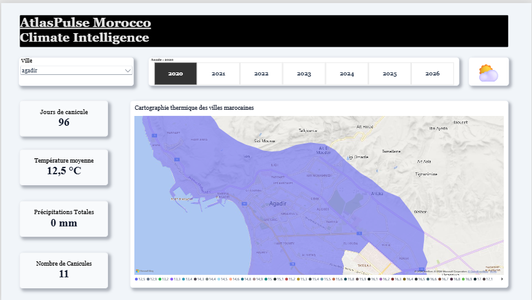
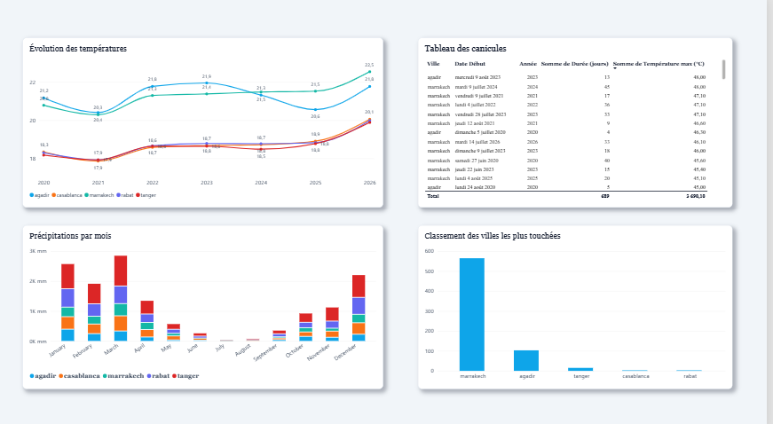
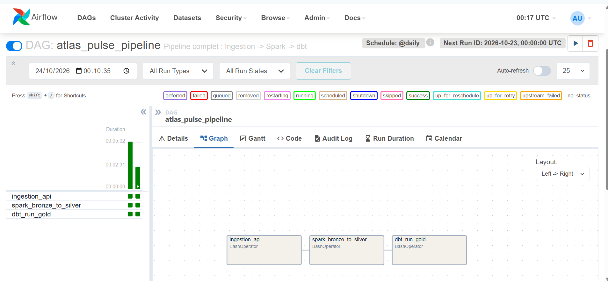
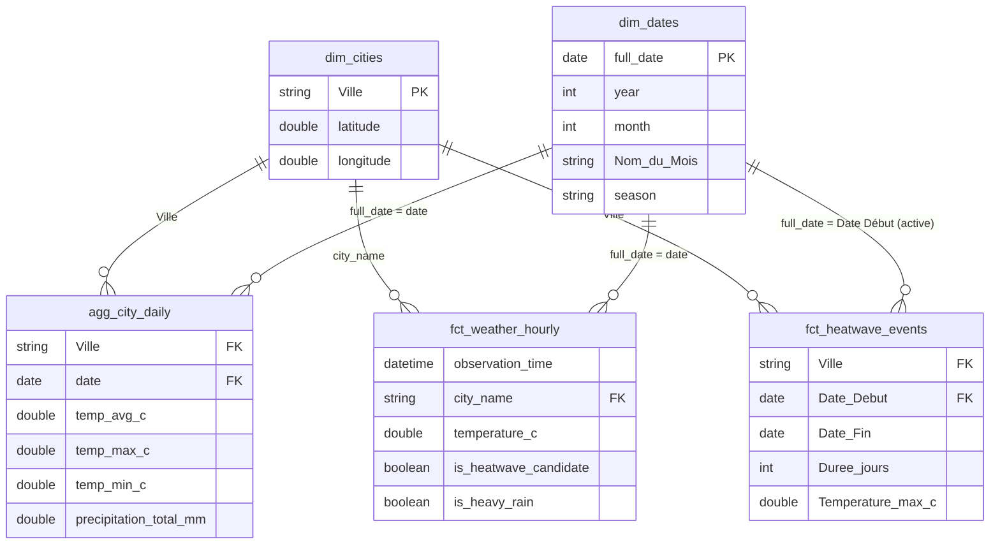

# AtlasPulse — Morocco Climate Intelligence

**AtlasPulse** est un projet complet de Data Engineering qui collecte, stocke, transforme et modélise des données météorologiques horaires pour cinq villes marocaines. L'objectif est de construire un pipeline de données de bout en bout (End-to-End) permettant d'étudier les épisodes de chaleur et les fortes précipitations.

> **État du projet :** ✅ **Terminé.** Le pipeline complet est opérationnel et automatisé, de l'ingestion API jusqu'au tableau de bord décisionnel.

---

## Aperçu du Dashboard (Power BI)

### Vue d'ensemble et cartographie


### Tendances et analyse mensuelle & Événements extrêmes (canicules)


---

## Sommaire

- [Contexte et objectifs](#contexte-et-objectifs)
- [Stack technique](#stack-technique)
- [Résultats actuels](#résultats-actuels)
- [Architecture du pipeline](#architecture-du-pipeline)
- [Orchestration avec Apache Airflow](#orchestration-avec-apache-airflow)
- [Modèle de données Power BI](#modèle-de-données-power-bi)
- [Mesures DAX](#mesures-dax)
- [Contrôles de qualité (dbt)](#contrôles-de-qualité-dbt)
- [Installation et exécution](#installation-et-exécution)
- [Auteur](#auteur)

---

## Contexte et objectifs

Les organisations qui disposent d'équipes terrain au Maroc ont besoin de suivre les conditions météorologiques pour prévenir les risques. AtlasPulse transforme des données météo brutes en indicateurs métier exploitables.

Le projet répond à des questions telles que :

- Quelles villes enregistrent les températures les plus extrêmes ?
- Comment les températures et les précipitations évoluent-elles depuis 2020 ?
- Quand et où observe-t-on des canicules (épisodes de chaleur consécutifs) ?

### Objectifs Data Engineering

- Ingestion de données depuis une API externe avec traitement incrémental.
- Architecture « Medallion » (Bronze / Silver / Gold).
- Transformation distribuée avec PySpark.
- Entrepôt de données cloud (BigQuery Sandbox).
- Modélisation analytique et tests de qualité avec dbt.
- **Orchestration et automatisation avec Apache Airflow.**
- Visualisation avec Power BI.

---

## Stack technique

| Composant | Technologie | Statut |
| :--- | :--- | :--- |
| **Source de données** | API Open-Meteo | ✅ Implémenté |
| **Ingestion** | Python, `requests`, `pandas` | ✅ Implémenté |
| **Stockage local (Bronze/Silver)** | Parquet (partitionné) | ✅ Implémenté |
| **Transformation** | PySpark 3.5 (Docker, Java 17) | ✅ Implémenté |
| **Entrepôt cloud** | Google BigQuery (Sandbox) | ✅ Implémenté |
| **Modélisation & tests** | dbt (Data Build Tool) | ✅ Implémenté |
| **Orchestration** | **Apache Airflow (Docker)** | ✅ **Implémenté** |
| **Visualisation** | Power BI Desktop | ✅ Implémenté |

---

## Résultats actuels

| Indicateur | Résultat |
| :--- | :--- |
| Villes couvertes | 5 (Casablanca, Rabat, Marrakech, Tanger, Agadir) |
| Période couverte | 2020 à 2026 (6 ans et 3/4) |
| Lignes dans les couches Bronze / Silver | **297 720 lignes** horaires |
| Fichiers Parquet générés | 35 |
| Temps de transformation Silver | Environ 34,7 secondes |
| Tables Gold créées dans BigQuery | 6 modèles dbt |
| Qualité des données | 0 doublon, 0 null (validé par 6 tests dbt) |
| Orchestration | 3 tâches automatisées dans un DAG Airflow |

---

## Architecture du pipeline

```text
                   ┌─────────────────────────┐
                   │   Apache Airflow        │
                   │ (Orchestrateur / DAG)   │
                   └────────────┬────────────┘
                                │ Déclenche et surveille les tâches
                                ▼
                   ┌─────────────────────────┐
                   │      Open-Meteo API     │
                   └────────────┬────────────┘
                                │ (Python, ingestion incrémentale)
                                ▼
          ┌────────────────────────────────────────┐
          │                BRONZE                  │
          │ Données brutes en Parquet              │
          └────────────────────┬───────────────────┘
                               │ (PySpark 3.5)
                               ▼
          ┌────────────────────────────────────────┐
          │                SILVER                  │
          │ Données nettoyées, typées, validées    │
          └────────────────────┬───────────────────┘
                               │ (Script Python / BigQuery API)
                               ▼
          ┌────────────────────────────────────────┐
          │            BIGQUERY (Cloud)            │
          │ Table source : weather_clean           │
          └────────────────────┬───────────────────┘
                               │ (dbt)
                               ▼
          ┌────────────────────────────────────────┐
          │                 GOLD                   │
          │ 6 tables analytiques (modèle en étoile)│
          │ - Dimensions (villes, dates)           │
          │ - Faits (météo horaire, quotidien)     │
          │ - Événements (canicules)               │
          └────────────────────┬───────────────────┘
                               │ (Import OAuth)
                               ▼
          ┌────────────────────────────────────────┐
          │                POWER BI                │
          │ Dashboard interactif (2 pages)         │
          └────────────────────────────────────────┘
```

### Détail des couches

- **Bronze** : données brutes de l'API stockées en Parquet. L'ingestion boucle année par année pour éviter les timeouts.
- **Silver** : nettoyage avec PySpark (déduplication, vérification des bornes météo, calcul d'indicateurs simples).
- **Gold** (BigQuery + dbt) :
  - `dim_cities` et `dim_dates` : dimensions.
  - `agg_city_daily` et `fct_weather_hourly` : faits.
  - `fct_heatwave_events` : modèle SQL avancé détectant les canicules (jours consécutifs > 35 °C).

---

## Orchestration avec Apache Airflow

Le pipeline est entièrement automatisé via **Apache Airflow**, exécuté dans un conteneur Docker avec `LocalExecutor`. Le DAG `atlas_pulse_pipeline` s'exécute quotidiennement (`@daily`) et gère les dépendances entre les tâches.

### Structure du DAG

Le DAG est composé de trois tâches séquentielles :

1. `ingestion_api` (BashOperator) : exécute le script Python de téléchargement des données.
2. `spark_bronze_to_silver` (BashOperator) : lance le conteneur PySpark via le socket Docker (`sudo docker exec`).
3. `dbt_run_gold` (BashOperator) : exécute les modèles dbt pour mettre à jour BigQuery.

### Configuration Docker et accès

L'environnement Airflow est défini dans le `docker-compose.yml` :

- **Ports** : l'interface web d'Airflow est accessible sur `http://localhost:8081` (port choisi pour éviter les conflits avec d'autres projets).
- **Volumes** : partage de `gcp-key.json` et `profiles.yml` pour que dbt puisse s'authentifier sur Google Cloud.
- **Permissions** : l'image personnalisée `Dockerfile.airflow` accorde les droits `sudo` à l'utilisateur Airflow pour qu'il puisse communiquer avec le démon Docker.

### Aperçu du DAG

L'image ci-dessous montre l'interface d'Airflow avec les 3 tâches exécutées avec succès (en vert).



---

## Modèle de données Power BI

Le rapport s'appuie sur un **schéma en étoile** : deux dimensions (`dim_cities`, `dim_dates`) filtrent trois tables de faits. Toutes les relations sont de type 1 → * avec un filtrage dans un seul sens.



### Règles de modélisation

| Règle | Détail |
| :--- | :--- |
| Date automatique désactivée | Évite les tables cachées `LocalDateTable_…` |
| `dim_dates` marquée comme table de dates | Nécessaire pour les comparaisons N-1 |
| Relation inactive `Date Fin` | Activée à la demande avec `USERELATIONSHIP` |
| Segments sur les dimensions | `dim_cities[Ville]` et `dim_dates[year]`, jamais sur une table de faits |
| Table `_Mesures` | Contient toutes les mesures, séparées des tables de données |
| Colonnes techniques masquées | Clés de jointure, `threshold_c`, etc. |
| Table de staging exclue | `stg_weather` n'est pas chargée dans le rapport |

---

## Mesures DAX

```DAX
-- Climat
Temp Moyenne = AVERAGE ( agg_city_daily[Température Moyenne (°C)] )
Temp Max Record = MAX ( agg_city_daily[temp_max_c] )
Temp Min Record = MIN ( agg_city_daily[temp_min_c] )
Précipitations (mm) = SUM ( agg_city_daily[Précipitations Totales] )
Jours de Pluie =
CALCULATE ( COUNTROWS ( agg_city_daily ), agg_city_daily[Précipitations Totales] >= 1 )

-- Canicules
Nb Canicules = COUNTROWS ( fct_heatwave_events )
Jours de Canicule = SUM ( fct_heatwave_events[Durée (jours)] )
Durée Moyenne Canicule = DIVIDE ( [Jours de Canicule], [Nb Canicules] )
Temp Max Canicule = MAX ( fct_heatwave_events[Température max (°C)] )

-- Comparaison avec l'année précédente
Jours Canicule N-1 =
CALCULATE ( [Jours de Canicule], SAMEPERIODLASTYEAR ( dim_dates[full_date] ) )

Variation Canicule % =
DIVIDE ( [Jours de Canicule] - [Jours Canicule N-1], [Jours Canicule N-1] )

-- Classement et en-tête
Ville la Plus Touchée =
MAXX ( TOPN ( 1, ALLSELECTED ( dim_cities[Ville] ), [Jours de Canicule], DESC ), dim_cities[Ville] )

Dernière Mise à Jour = MAX ( agg_city_daily[date] )
```

> **Note :** une canicule qui chevauche deux années est comptée entièrement dans l'année de son début, car la relation active passe par `Date Début`. L'année 2026 est partielle : elle est à filtrer ou à signaler dans les visuels de tendance.

---

## Contrôles de qualité (dbt)

Les tests dbt garantissent l'intégrité des données dans l'entrepôt :

- **Unicité** : clés primaires uniques (`city_name`, `event_id`).
- **Non-nullité** : aucune valeur manquante sur les colonnes critiques (températures, dates).
- **Relations** : vérification que chaque événement est associé à une ville existante dans la dimension.

---

## Installation et exécution

### Prérequis

- Python 3.11+
- Docker Desktop
- Compte Google Cloud (avec BigQuery Sandbox)
- Git

### 1. Démarrage de l'infrastructure (Airflow + Spark + PostgreSQL)

```powershell
# Construction de l'image Airflow personnalisée
docker compose build

# Démarrage de tous les services en arrière-plan
docker compose up -d

# Vérification de l'état (attendre que airflow-init soit terminé)
docker compose ps
```

L'interface Airflow est accessible sur **`http://localhost:8081`** (identifiants : `airflow` / `airflow`).

### 2. Déclenchement du pipeline

1. Connectez-vous à l'interface Airflow.
2. Activez le DAG `atlas_pulse_pipeline` (bouton à gauche).
3. Cliquez sur **Trigger DAG** (bouton Play).
4. Suivez l'exécution des 3 tâches dans la vue **Graph**.

### 3. Visualisation

Ouvrez Power BI Desktop, connectez-vous à votre projet BigQuery (`atlas_pulse_gold`) et chargez les tables `dim_cities`, `dim_dates`, `agg_city_daily`, `fct_weather_hourly` et `fct_heatwave_events`. Vérifiez ensuite les relations décrites dans la section [Modèle de données Power BI](#modèle-de-données-power-bi).

---

## Auteur

**Fatima Chegdani**
Élève ingénieure en Génie Informatique et Intelligence Artificielle — ENSA Safi

- LinkedIn : [www.linkedin.com/in/fatima-chegdani-44b840274](https://www.linkedin.com/in/fatima-chegdani-44b840274)
- GitHub : [Fatima1234-cheg](https://github.com/Fatima1234-cheg)
